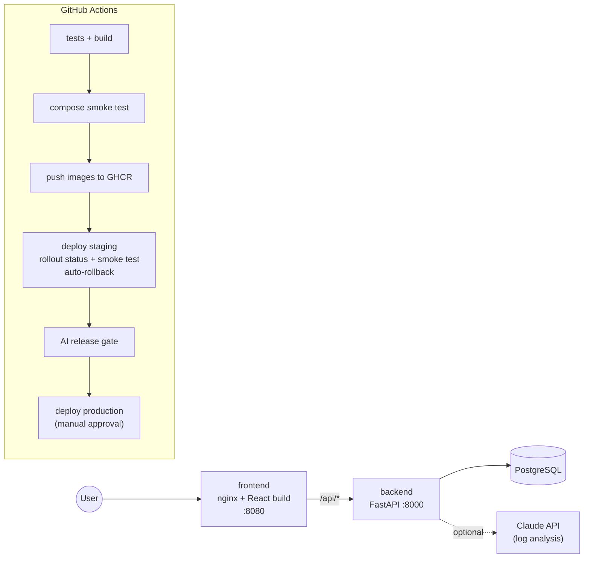

# Idea Board: AI-First, Cloud-Agnostic DevOps Platform (MVP)

A small Idea Board app (React + FastAPI + PostgreSQL) shipped through a complete DevOps toolchain:
Docker, Docker Compose, Kubernetes (Kustomize), Terraform for AWS **and** GCP behind one module interface,
a GitHub Actions pipeline with health-gated rollouts and automatic rollback, and **AI-powered deployment
log analysis and release recommendations** (Claude, with a rule-based fallback).

---

## Verification status (please read)

| Area | Status |
|---|---|
| Backend API + 15 unit tests (ideas, health, AI rules, mocked LLM path) | ✅ Tested locally (`pytest`) |
| Frontend build + dev server talking to backend through `/api` proxy | ✅ Tested locally |
| AI analyzer CLI (rule-based path) on sample logs | ✅ Tested locally |
| Kubernetes manifests (staging + production overlays) | ✅ Rendered with `kubectl kustomize` and schema-validated with `kubeconform` |
| Terraform `fmt` / `validate` for AWS and GCP roots | ✅ Validated locally (no `plan`/`apply`) |
| Docker images + `docker compose up` | ⚠️ Not run locally (no Docker on the build machine). The CI job `compose-smoke-test` builds and tests the full stack on every push. |
| LLM path against the real Claude API | ⚠️ Request/response handling is tested with a mocked client only; no live API key was used |
| Deploying to AWS (EKS) / GCP (GKE) | ❌ **Not verified.** Terraform is valid but has never been applied. |
| Automatic rollback on a real cluster | ❌ **Not verified.** Implemented in `scripts/deploy.sh` (render logic tested); needs a real cluster run (see [Rollback demo](#rollback-demo)). |

---

## Architecture



* **Cloud-agnostic by design:** images live in GHCR (no cloud registry lock-in), apps are plain Kubernetes
  manifests, and Terraform exposes **one cluster interface** with an AWS and a GCP implementation.
* **One config surface:** every setting is an environment variable (`.env` locally, ConfigMap/Secret on Kubernetes,
  GitHub Secrets in CI). No credentials are stored in the repo.

## Project structure

```
.
├── backend/                 FastAPI app
│   ├── app/
│   │   ├── main.py          routes: ideas, /health, /ready, /api/version, AI endpoints
│   │   ├── config.py        environment-based settings
│   │   ├── database.py      SQLAlchemy engine/session
│   │   ├── models.py        Idea table
│   │   ├── schemas.py       request/response models (incl. AI output schemas)
│   │   ├── ai.py            Claude-powered log analysis + recommendations, rule-based fallback
│   │   └── analyze_cli.py   same AI features as a CLI for the pipeline
│   ├── tests/               pytest suite (SQLite, no network)
│   ├── Dockerfile
│   └── requirements*.txt
├── frontend/                React + Vite UI (Idea Board + AI Deployment Assistant)
│   ├── src/
│   ├── nginx.conf           serves the SPA, proxies /api -> backend:8000
│   └── Dockerfile           multi-stage: node build -> nginx-unprivileged
├── docker-compose.yml       db + backend + frontend for local dev
├── .env.example
├── k8s/
│   ├── base/                postgres, backend, frontend (+ probes, rollout strategy, PDB)
│   └── overlays/{staging,production}/   namespace, replicas, APP_ENV, image tags
├── terraform/
│   ├── modules/aws-cluster/ VPC + EKS + node group + EBS CSI
│   ├── modules/gcp-cluster/ GKE Standard + node pool
│   └── environments/{aws,gcp}/  root configs + staging/production .tfvars
├── scripts/
│   ├── deploy.sh            apply -> wait -> smoke test -> AI analysis -> rollback on failure
│   ├── rollback.sh          manual rollback
│   └── smoke_test.sh        end-to-end check through nginx
├── samples/logs/            failing + healthy rollout logs for the AI demo
└── .github/workflows/ci-cd.yml
```

> **Repository layout note:** GitHub only reads workflows from `.github/` at the **repository root**, so this
> folder should be its own repository (`git init` here, or push it as the root of a new repo).

---

## Quick start: Docker Compose

Requirements: Docker Desktop (or Docker Engine + Compose v2).

```bash
cp .env.example .env
# edit .env: set POSTGRES_PASSWORD (any value); optionally ANTHROPIC_API_KEY
docker compose up --build
```

| URL | What |
|---|---|
| http://localhost:3000 | Idea Board UI |
| http://localhost:8000/docs | Swagger UI for the API |
| http://localhost:8000/ready | readiness (checks the DB) |

End-to-end check (bash / Git Bash): `bash scripts/smoke_test.sh http://localhost:3000`

Startup order is enforced by health checks: `db` (pg_isready) → `backend` (`/health`) → `frontend`.

## Run without Docker (development)

```bash
# backend (Python 3.12+). Needs a Postgres; or use SQLite for a quick try:
cd backend
python -m venv .venv && source .venv/bin/activate     # Windows: .venv\Scripts\activate
pip install -r requirements-dev.txt
DATABASE_URL=sqlite:///./dev.db uvicorn app.main:app --reload --port 8000
pytest                                               # run the tests

# frontend (Node 20+), in another terminal
cd frontend
npm install
npm run dev                                          # http://localhost:5173, proxies /api to :8000
```

## Configuration

| Variable | Default | Purpose |
|---|---|---|
| `APP_ENV` | `development` | `development` / `staging` / `production` (shown in the UI badge) |
| `APP_VERSION` | `dev` | Release id; CI bakes the git SHA into the image |
| `DATABASE_URL` | – | Full SQLAlchemy URL; overrides the `POSTGRES_*` values |
| `POSTGRES_HOST` / `PORT` / `DB` / `USER` | `localhost` / `5432` / `ideaboard` / `ideaboard` | DB location |
| `POSTGRES_PASSWORD` | **required** | Never has a default |
| `ANTHROPIC_API_KEY` | empty | Enables Claude; empty = rule-based analyzer |
| `AI_MODEL` | `claude-opus-5-5` | Claude model id |
| `AI_MAX_LOG_CHARS` | `200000` | Larger input is rejected (HTTP 413), never silently truncated |
| `CORS_ORIGINS` | `http://localhost:5173` | Only needed when UI and API are on different origins |
| `SIMULATE_UNHEALTHY` | `false` | Makes `/ready` return 503, to demo rollback |

Per environment: `.env` (local) → `k8s/overlays/<env>` ConfigMap values + Kubernetes Secrets → GitHub Environment secrets.

## API

| Method | Path | Description |
|---|---|---|
| GET | `/api/ideas` | List ideas (newest first) |
| POST | `/api/ideas` | Create `{ "title": "...", "description": "..." }` → 201 |
| GET | `/health` | Liveness: process is up (no dependencies) |
| GET | `/ready` | Readiness: DB reachable → 200, otherwise 503 |
| GET | `/api/version` | `{version, environment}`: confirms which release is live |
| POST | `/api/ai/analyze-logs` | `{ "logs": "...", "context": "..." }` → status, root cause, issues, fixes, `proceed/investigate/rollback` |
| POST | `/api/ai/deployment-recommendation` | health signals → `deploy/canary/hold/rollback` + strategy, reasons, checks |

---

## AI features

**1. Deployment log analysis.** Paste `kubectl logs`/events or `docker compose logs` into the UI's
*AI Deployment Assistant* (or use the "Load failing logs" sample). The backend asks Claude for a
**structured JSON answer** that matches a schema (`status`, `root_cause`, `issues`, `suggested_fixes`,
`recommendation`, `confidence`), validates it with Pydantic, and returns it.

**2. Deployment recommendation.** Given environment, error rate, p95 latency, pod restarts, test result and
recent logs, the model returns `deploy`, `canary`, `hold` or `rollback` plus a strategy, reasons and checks.

**How it is wired** (`backend/app/ai.py`):
* Anthropic Python SDK, model from `AI_MODEL` (default `claude-opus-5-5`), structured outputs via
  `output_config.format` (JSON schema).
* Server-side refusal fallbacks are enabled (`fallbacks="default"`). If the model declines, the API retries on
  a fallback model automatically.
* **No key, API error or refusal → rule-based analyzer** (regexes for CrashLoopBackOff, OOMKilled,
  ImagePullBackOff, probe failures, DB errors, tracebacks, …). Every response has `source: "llm" | "rules"`
  and a `note`, so it is always clear which one answered.

**In the pipeline** (`python -m app.analyze_cli`):
* Every deploy collects pod status, events and logs into `deploy-logs/<env>.log`, analyzes them and writes a
  Markdown report to the GitHub job summary.
* Before production, an **AI release gate** runs `analyze_cli recommend` on the staging logs; `hold` or
  `rollback` stops the production job.
* **Safety rule:** the AI is advisory for rollback. The rollback decision is made by objective checks
  (`kubectl rollout status` + smoke test), so a wrong model answer can never roll back a healthy release or
  keep a broken one.

```bash
cd backend
python -m app.analyze_cli logs ../samples/logs/failed-deploy.log        # exit 0 proceed / 1 investigate / 2 rollback
python -m app.analyze_cli recommend --environment production --logs ../samples/logs/healthy-deploy.log
```

---

## Health checks and safe rollback design

| Layer | Mechanism |
|---|---|
| Docker / Compose | `HEALTHCHECK` on both images; `depends_on: condition: service_healthy` |
| Kubernetes probes | `startupProbe` + `livenessProbe` on `/health` (restart hung process, ignore DB outages); `readinessProbe` on `/ready` (only route traffic when the DB answers) |
| Rollout strategy | `RollingUpdate` with `maxUnavailable: 0`, `maxSurge: 1`: old pods keep serving until new pods are Ready. A broken release never reduces capacity. |
| Failure detection | `progressDeadlineSeconds: 120` + `kubectl rollout status --timeout`, then an in-cluster smoke test of `/ready` and `/api/ideas` |
| Rollback | `scripts/deploy.sh` records each Deployment's revision **before** applying. On failure it runs `kubectl rollout undo --to-revision=<previous>` only for Deployments this deploy changed, waits for them to become healthy, and fails the job. `revisionHistoryLimit: 5` keeps old ReplicaSets. |
| Config changes | ConfigMaps are generated with a content hash, so a config change is a new revision and is rolled back together with the code |
| Disruptions | `PodDisruptionBudget` (`maxUnavailable: 1`) for the backend |
| Manual | `scripts/rollback.sh <env> [revision]` |

Limitations: the database schema is created with `create_all` (additive only). Releases that change the schema
need backward-compatible migrations (e.g. Alembic, expand/contract) before code rollback is fully safe.

### Rollback demo

Requires a cluster (any: kind, minikube, EKS, GKE) and a previous healthy deploy:

```bash
export POSTGRES_PASSWORD=<choose one>
# 1) healthy release
bash scripts/deploy.sh staging ghcr.io/<owner>/ideaboard-backend:<sha> ghcr.io/<owner>/ideaboard-frontend:<sha>
# 2) deliberately broken release: /ready returns 503, rollout stalls, script rolls back
SIMULATE_UNHEALTHY=true bash scripts/deploy.sh staging <same images>
kubectl -n ideaboard-staging rollout history deployment/backend
```

In GitHub: **Actions → CI/CD → Run workflow → "simulate_bad_release"** does step 2 on staging.

---

## Kubernetes (manual deploy)

```bash
kubectl kustomize k8s/overlays/staging          # inspect the rendered manifests
bash scripts/deploy.sh staging <backend-image> <frontend-image>
kubectl -n ideaboard-staging port-forward svc/frontend 8080:80   # open http://localhost:8080
```

* Secrets are created by `deploy.sh` from `POSTGRES_PASSWORD` / `ANTHROPIC_API_KEY` env vars, or manually:
  `kubectl -n <ns> create secret generic ideaboard-db --from-literal=POSTGRES_PASSWORD=...`
* GHCR packages are **private by default**. Either make `ideaboard-backend` / `ideaboard-frontend` public
  (GitHub → Packages → Settings), or add an `imagePullSecret` to the Deployments.
* Production overlay: 3 backend replicas, frontend Service of type `LoadBalancer`.
* Postgres runs in-cluster as a StatefulSet for the MVP. For production use RDS / Cloud SQL and change `POSTGRES_HOST`.

## Terraform: one interface, two clouds

`modules/aws-cluster` and `modules/gcp-cluster` share the **same inputs** (`name`, `environment`, `region`,
`node_count`, `node_size` = `small|medium|large`, `kubernetes_version`) and the **same outputs**
(`cloud`, `cluster_name`, `cluster_endpoint`, `cluster_ca_certificate`, `kubeconfig_command`).
The cloud-neutral `node_size` maps to `t3.*` on AWS and `e2-*` on GCP. Switching cloud means using the other
root folder with the same `.tfvars`. Nothing downstream (k8s manifests, pipeline) changes.

```bash
# AWS (credentials from your AWS profile/SSO)
cd terraform/environments/aws
terraform init
terraform workspace select -or-create staging
terraform plan -var-file=staging.tfvars
terraform apply -var-file=staging.tfvars
$(terraform output -raw kubeconfig_command)

# GCP (gcloud auth application-default login)
cd terraform/environments/gcp
export TF_VAR_project_id=<your-project>
terraform init && terraform workspace select -or-create staging
terraform apply -var-file=staging.tfvars
```

Notes: state is local by default (commented S3/GCS backends are included for teams). The AWS module uses
public subnets only (no NAT cost) to stay minimal. These modules are **validated but have not been applied**;
expect to adjust things like EKS version/AZ availability on first real use. On EKS, if PVCs stay `Pending`,
create a default StorageClass for the EBS CSI driver (`gp3`).

## CI/CD (GitHub Actions)

`.github/workflows/ci-cd.yml`:

| Job | Runs on | What |
|---|---|---|
| `backend-tests` | PR + push | pytest; AI analysis of the sample failing log into the job summary |
| `frontend-build` | PR + push | `npm ci && npm run build` |
| `iac-validate` | PR + push | `terraform fmt -check`, `terraform validate` (AWS + GCP), `kubeconform` on both overlays |
| `compose-smoke-test` | PR + push | `docker compose up --wait`, `scripts/smoke_test.sh`, AI analysis of logs on failure |
| `publish-images` | push to `main` | Build + push both images to GHCR tagged with the commit SHA |
| `deploy-staging` | after publish | `scripts/deploy.sh staging` with auto-rollback; logs + AI report uploaded |
| `deploy-production` | after staging | AI release gate → `scripts/deploy.sh production`; use the `production` environment's *Required reviewers* for manual approval |

**Setup**
1. Settings → Environments: create `staging` and `production`. In each, add secrets
   `KUBE_CONFIG` (`base64 -w0 kubeconfig`) and `POSTGRES_PASSWORD`. Add required reviewers to `production`.
2. Settings → Secrets → Actions: optionally add `ANTHROPIC_API_KEY`.
3. Without `KUBE_CONFIG` the deploy jobs **skip with a notice**, so CI is green on a fresh fork.

## Next steps (beyond the MVP)

Alembic migrations · managed Postgres · Ingress + TLS · OIDC instead of kubeconfig secrets ·
Prometheus metrics feeding real error-rate/latency numbers into the recommendation step ·
progressive delivery (Argo Rollouts) for real canaries · image scanning (Trivy) in CI.
